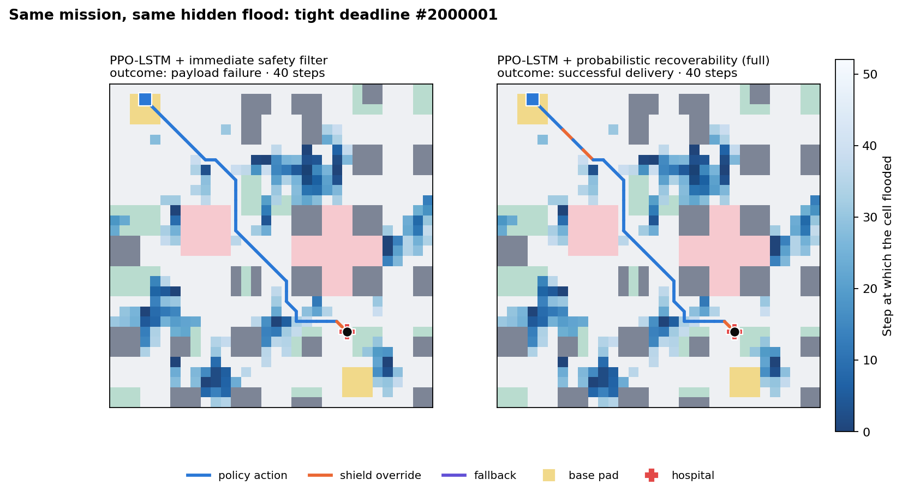

# RescueRoute

**Forecast-aware recoverability for emergency medical UAV navigation in stochastic urban floods.**

A single UAV must deliver a medical payload across a flooding city before a deadline, keep a fragile payload stable,
manage its battery under wind, and still be able to reach a safe landing site afterwards. RescueRoute asks one research
question:

> *Can forecast-conditioned, action-level recoverability checks reduce future mission failures while preserving on-time
> delivery, compared with policies that only check immediate feasibility?*



## What is in this repository

| Area | What it does | Where |
|---|---|---|
| Simulator (Environment V1.1) | Gymnasium env: Manhattan32 map, 9 actions, 7×17×17 + 15-d partial observation, stochastic wind, rain, flood CA, payload stability, battery, deadline, probabilistic flood forecast. **Bit-identical to the original V1** (vectorised, ~1.5× faster) | `src/rescue_route/env`, `weather`, `hazards`, `payload`, `forecast` |
| Weather validation | ERA5 (Open-Meteo) validation of the rain and wind processes, plus calibrated V2 alternatives | `src/rescue_route/validation`, `reports/weather_validation/` |
| Planning utilities | Exact time-expanded reachability (oracle feasibility, consequence evaluator), geodesic distance field, and a full-map shortest-path planner used **only as the training teacher** for imitation (not a benchmark method) | `src/rescue_route/planning` |
| Learning | PPO (MLP, CNN, CNN+LSTM, CNN+LSTM+risk), privileged-teacher initialisation (BC + DAgger), static-geometry action masking | `src/rescue_route/rl` |
| Safety layer | Immediate filter, **Monte-Carlo forecast consequence evaluator**, recoverability margin M_rec, P_unrec gate, graded fallback (RTB / rooftop landing / hover) | `src/rescue_route/safety` |
| Evaluation | 9 methods × 11 stress profiles × 100 held-out seeds (9,900 paired episodes); paired bootstrap; oracle feasibility; post-hoc recovery check | `src/rescue_route/evaluation`, `reports/evaluation/` |
| Demo | Isometric 2.5D Mission Control: replay, side-by-side comparison, live simulation, benchmark and weather pages | `src/rescue_route/demo/web` |
| Docs | **Complete guide to every folder, file, module, the workflow and the algorithms** · source-audited formula inventory | `docs/PROJECT_GUIDE.md` · `docs/FORMULA_INVENTORY.md` |

## Results (held-out test seeds, all 11 stress profiles pooled, 1,100 paired missions per method)

| Method | Success | Success + recovery | **UAV lost** | Future failure | Safe abort |
|---|---:|---:|---:|---:|---:|
| PPO + CNN + LSTM | 33.4 % | 31.9 % | 35.5 % | 20.8 % | 0 % |
| + immediate safety filter | 38.4 % | 36.4 % | 31.1 % | 27.1 % | 0 % |
| + deterministic recoverability | 36.5 % | 36.1 % | 6.5 % | 9.0 % | 48.5 % |
| **+ probabilistic recoverability (full method)** | **38.8 %** | **38.5 %** | **6.1 %** | **7.9 %** | 50.9 % |

* The full method delivers the most missions of all methods. Against the immediate filter it cuts UAV losses by
  **25.0 pp** (95 % paired-bootstrap CI −27.6 to −22.4) and increases delivered-*and*-recoverable missions by
  **+2.1 pp** (CI +0.8 to +3.5). Raw delivery is unchanged (+0.5 pp, CI −1.1 to +2.0).
* "Future failures" (every executed action passed the immediate check, but the mission was lost later) fall from 27.1 % to 7.9 %.
* Normal missions: 71 % delivered (immediate filter 69 %, raw policy 60 %). Dynamic flood: UAV losses fall from 66 % (immediate filter) to 13 %,
  with the most deliveries of any method. Many hard-profile missions are infeasible even for a
  clairvoyant oracle (36–52 %), and the remaining aborts are mostly genuine. Typical causes: a fragile payload that cannot
  be re-stabilised before the deadline, or a battery that cannot reach a landing site after delivery.
* Deliverability came from two shield improvements, both fitted without touching the test seeds:
  1. **Forecast recalibration.** Isotonic, per lead time × forecast reliability, fitted on training seeds; Brier 0.115 → 0.103.
     It removes the 2–4× over-forecast at short leads that caused false alarms.
  2. **Tuned thresholds.** δ = 0.3 and abort threshold δ_abort = 0.85, chosen on validation seeds to maximise
     delivered-and-recoverable missions subject to a ≤ 8 % UAV-loss budget.
* Learning ablations: PPO fine-tuning beats the behaviour-cloned student (+4.1 pp success, CI +2.1 to +6.1). The CNN beat
  the LSTM in this setting, and the risk-reward variant helped slightly.

Full tables: `reports/evaluation/evaluation_report.md` · **every method × every profile with discussion:** `reports/evaluation/profile_report.md` · weather: `reports/weather_validation/weather_validation_report.md` ·
training curves: `reports/training/training_curves.png`.

## Quick start

```bash
pip install -r requirements.txt
```

```bash
python -m pytest
```

```bash
python scripts/run_demo.py
```

`run_demo.py` opens **Mission Control** at http://127.0.0.1:8765, where you can replay the showcase missions or simulate any
method, profile and seed live. Without Python, open `src/rescue_route/demo/web/index.html` directly to view the recorded missions.

### Reproduce everything

```bash
python scripts/validate_weather.py
```

```bash
python scripts/pretrain.py
```

```bash
python scripts/calibrate_forecast.py
```

```bash
python scripts/train.py --variant all
```

```bash
python scripts/evaluate.py --stage all
```

```bash
python scripts/export_demo.py
```

| Step | Output | Time (32-thread CPU + RTX 4060) |
|---|---|---|
| `validate_weather.py` | `reports/weather_validation/weather_validation_report.md`, `configs/weather_v2_calibrated.json` | < 1 min (ERA5 cached in `data/weather`) |
| `pretrain.py` | `outputs/models/bc_{mlp,cnn,cnn_lstm}.pt` (BC + 2 DAgger rounds) | ~20 min |
| `calibrate_forecast.py` | `configs/forecast_calibration.json` (shield's forecast recalibration) | ~3 min |
| `train.py --variant all` | `outputs/models/ppo_*/{best,final}.pt` + `progress.csv` (2 M steps each) | ~1.5 h (two variants in parallel) |
| `evaluate.py --stage all` | thresholds tuned on validation seeds, then `reports/evaluation/evaluation_report.md` | ~60 min |
| `export_demo.py` | `src/rescue_route/demo/web/data/demo_data.js` | ~2 min |

## The method in one picture

```
observation (7×17×17 + 15)  ──►  PPO actor (CNN + LSTM)  ──►  π(a | o, h)
                                                               │
current flood + forecast p_h + wind  ──►  K = 16 forecast-conditioned futures
          (PlannerView: no hidden truth)       │  monotone flood masks  F_k[h] = 1[U_k < p_h]
                                               │  stochastic wind (AR(1) speed, gusts)
                                               ▼
                         exact time-expanded min-energy search in each future
                         → delivery time, energy, payload hover allowance, return-to-landing energy
                                               ▼
              M_rec^k = min((τ_D − T̂_D)/τ₀ , (B − Ê_D − Ê_R − B_res)/B₀)
              P_unrec(a) = mean_k 1[M_rec^k < 0]
                                               ▼
  A_safe = {a : immediately feasible ∧ P_unrec ≤ δ}  →  argmax π over A_safe
  empty → least-risk action within ε of the minimum  →  if min P_unrec ≥ ½ (confirmed with K = 48): RTB / rooftop landing
```

## Design decisions (and why)

* **Formulas were audited before anything changed.** See `docs/FORMULA_INVENTORY.md`. The V1 simulator is preserved
  exactly (`tests/test_v1_equivalence.py` replays episodes against the original code).
* **Scenario ranges rebalanced, not formulas.** A clairvoyant oracle could solve only 62 % of normal and 0 % of
  dynamic-flood V1 missions. `scenario_version="v1.1"` rescales two flood scenario ranges; `"v1"` is still available.
* **Training reward v1.1.** In V1, crashing into a flood (−30) is cheaper than missing the deadline (−50), so a failing
  agent learns to crash early. Training uses −60 for hazards and geodesic progress; evaluation uses mission outcomes.
* **Privileged-teacher initialisation.** PPO from scratch converged to "hover until the deadline": long detours around
  buildings and water were never discovered. Every PPO variant therefore starts from the same behaviour-cloned + DAgger
  policy (teacher: a shortest-path planner that sees the full flood map, used only during training; student: local view only)
  and is then fine-tuned with PPO.
* **Static-geometry action masking only.** Buildings, NFZs and the map edge are masked for learned policies. Dynamic
  hazards are not, so the safety ablations stay meaningful.
* **Weather validation uses the simulator's own classes**, and better models were adopted only where held-out ERA5 data
  favoured them (two-scale latent-Gaussian rain; diurnal VAR(1) wind).

## Honest limitations

* The flood model is a synthetic cellular automaton. It is not calibrated to observed floods, and its wind→flood term is a heuristic.
* Weather is validated at one location and season (Mumbai, JJAS) at the ERA5 hourly scale. One simulator step is taken as one hour of weather.
* The evaluator's controller is clairvoyant within each sampled future, so its feasibility estimates are optimistic per sample.
  The sampling over futures is what supplies the caution.
* All results are simulator results. They measure the mechanism's relative effect, not real-world performance.

## Data and licences

ERA5 hourly reanalysis (Hersbach et al., 2020; Copernicus Climate Change Service), accessed through the Open-Meteo
Historical Weather API (CC BY 4.0). Map benchmark: Manhattan32 / Urban50 grids from the original RescueRoute repository.
