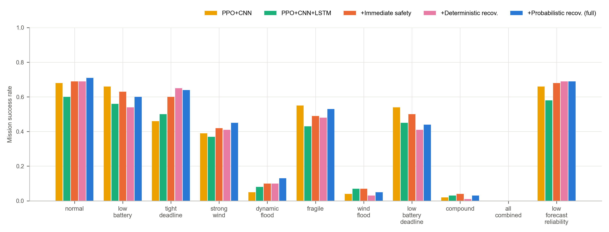
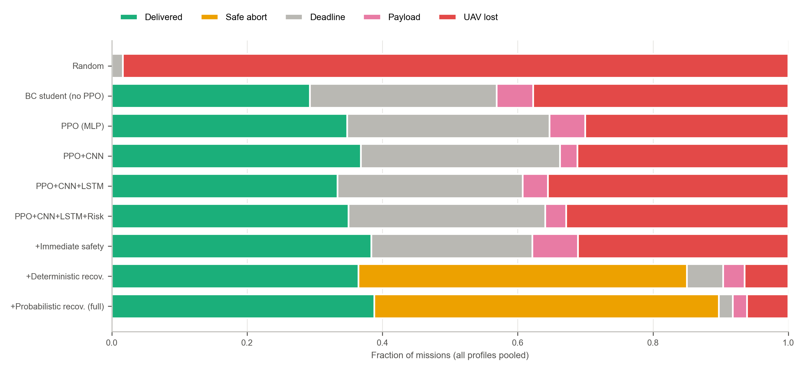
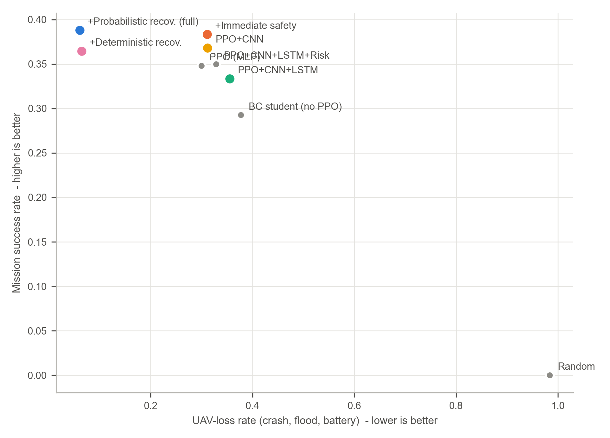

# RescueRoute — Benchmark evaluation

*Generated by `scripts/evaluate.py` from `episodes.csv` (9,900 episodes).*

**Protocol.** 9 methods × 11 stress profiles × 100 held-out test seeds (2,000,000+).
Every method sees exactly the same missions and the same hidden weather/flood realisations, so all comparisons are paired.
Environment V1.1 (frozen V1 formulas, rebalanced flood scenario ranges), V1 weather.
Shield threshold δ = 0.3 (selected on validation seeds 1,000,000+; never on test seeds).

**Definitions.** *Success*: delivered on time with a valid payload. *Success + recovery*: success, and the UAV can still reach a dry
base or rooftop on the TRUE future flood with its remaining battery minus a 10% reserve (checked post hoc). *UAV lost*: crash,
flood hazard/engulfment or empty battery. *Safe abort*: the fallback controller landed the UAV on a base or rooftop.
*Future failure*: the mission failed although every executed action had passed the immediate safety check.
*Oracle-feasible*: a clairvoyant controller with the true future could have delivered on time.

## Headline

| | Success | Success + recovery | UAV lost | Future failure | Safe abort |
|---|---:|---:|---:|---:|---:|
| PPO+CNN+LSTM | 33.4% | 31.9% | 35.5% | 20.8% | 0.0% |
| +Immediate safety | 38.4% | 36.4% | 31.1% | 27.1% | 0.0% |
| +Deterministic recov. | 36.5% | 36.1% | 6.5% | 9.0% | 48.5% |
| +Probabilistic recov. (full) | 38.8% | 38.5% | 6.1% | 7.9% | 50.9% |

* Compared with the conventional immediate filter, the probabilistic recoverability shield changes UAV losses by
  **-25.0 pp [95% CI -27.6, -22.4]**, raw delivery success by +0.5 pp [95% CI -1.1, +2.0], and
  delivered-*and*-recoverable missions by +2.1 pp [95% CI +0.8, +3.5].
* "Future failures" (the mission failed although every executed action passed the immediate check) fall from
  27.1% to 7.9%. This is the failure mode the recoverability criterion targets.
* Sampling futures beats checking one nominal future: against the deterministic variant, UAV losses change by
  -0.4 pp [95% CI -1.6, +0.9].
* The price is caution: 50.9% of missions end in a safe abort. Many are missions that even a clairvoyant
  oracle could not complete (see the oracle row in the profile table), or where the deadline was already lost.

## Overall results (all profiles pooled)

| Method | Success (95% CI) | Success+recovery | UAV lost | Flood | Deadline | Payload | Safe abort | Future failure | Intervention rate | Steps (succ.) |
|---|---:|---:|---:|---:|---:|---:|---:|---:|---:|---:|
| Random | 0.0% (0.0%–0.3%) | 0.0% | 98.4% | 46.1% | 1.6% | 0.0% | 0.0% | 2.5% | 0.0% | – |
| BC student (no PPO) | 29.3% (26.7%–32.0%) | 27.9% | 37.7% | 36.9% | 27.6% | 5.4% | 0.0% | 23.5% | 0.0% | 32.8 |
| PPO (MLP) | 34.8% (32.1%–37.7%) | 32.4% | 30.0% | 28.8% | 29.9% | 5.3% | 0.0% | 23.6% | 0.0% | 33.5 |
| PPO+CNN | 36.8% (34.0%–39.7%) | 34.3% | 31.2% | 30.6% | 29.5% | 2.5% | 0.0% | 21.0% | 0.0% | 34.3 |
| PPO+CNN+LSTM | 33.4% (30.6%–36.2%) | 31.9% | 35.5% | 34.7% | 27.4% | 3.7% | 0.0% | 20.8% | 0.0% | 33.6 |
| PPO+CNN+LSTM+Risk | 35.0% (32.2%–37.9%) | 33.5% | 32.8% | 32.1% | 29.1% | 3.1% | 0.0% | 17.2% | 0.0% | 34.4 |
| +Immediate safety | 38.4% (35.5%–41.3%) | 36.4% | 31.1% | 30.2% | 23.8% | 6.7% | 0.0% | 27.1% | 2.0% | 34.3 |
| +Deterministic recov. | 36.5% (33.7%–39.3%) | 36.1% | 6.5% | 6.4% | 5.4% | 3.2% | 48.5% | 9.0% | 34.7% | 34.2 |
| **+Probabilistic recov. (full)** | 38.8% (36.0%–41.7%) | 38.5% | 6.1% | 6.1% | 2.1% | 2.1% | 50.9% | 7.9% | 37.5% | 35.0 |

## Mission success by profile

| Method | normal | low battery | tight deadline | strong wind | dynamic flood | fragile | wind flood | low battery deadline | compound | all combined | low forecast reliability |
|---|---:|---:|---:|---:|---:|---:|---:|---:|---:|---:|---:|
| Random | 0.0% | 0.0% | 0.0% | 0.0% | 0.0% | 0.0% | 0.0% | 0.0% | 0.0% | 0.0% | 0.0% |
| BC student (no PPO) | 55.0% | 50.0% | 42.0% | 35.0% | 8.0% | 32.0% | 1.0% | 43.0% | 1.0% | 0.0% | 55.0% |
| PPO (MLP) | 65.0% | 61.0% | 51.0% | 34.0% | 8.0% | 44.0% | 2.0% | 53.0% | 1.0% | 0.0% | 64.0% |
| PPO+CNN | 68.0% | 66.0% | 46.0% | 39.0% | 5.0% | 55.0% | 4.0% | 54.0% | 2.0% | 0.0% | 66.0% |
| PPO+CNN+LSTM | 60.0% | 56.0% | 50.0% | 37.0% | 8.0% | 43.0% | 7.0% | 45.0% | 3.0% | 0.0% | 58.0% |
| PPO+CNN+LSTM+Risk | 66.0% | 56.0% | 51.0% | 36.0% | 8.0% | 49.0% | 6.0% | 47.0% | 5.0% | 0.0% | 61.0% |
| +Immediate safety | 69.0% | 63.0% | 60.0% | 42.0% | 10.0% | 49.0% | 7.0% | 50.0% | 4.0% | 0.0% | 68.0% |
| +Deterministic recov. | 69.0% | 54.0% | 65.0% | 41.0% | 10.0% | 48.0% | 3.0% | 41.0% | 1.0% | 0.0% | 69.0% |
| +Probabilistic recov. (full) | 71.0% | 60.0% | 64.0% | 45.0% | 13.0% | 53.0% | 5.0% | 44.0% | 3.0% | 0.0% | 69.0% |
| *Oracle-feasible missions* | *95.0%* | *95.0%* | *94.0%* | *93.0%* | *52.0%* | *95.0%* | *39.0%* | *94.0%* | *36.0%* | *46.0%* | *95.0%* |

## UAV-loss rate by profile

| Method | normal | low battery | tight deadline | strong wind | dynamic flood | fragile | wind flood | low battery deadline | compound | all combined | low forecast reliability |
|---|---:|---:|---:|---:|---:|---:|---:|---:|---:|---:|---:|
| Random | 99.0% | 100.0% | 93.0% | 98.0% | 100.0% | 99.0% | 100.0% | 94.0% | 100.0% | 100.0% | 99.0% |
| BC student (no PPO) | 24.0% | 33.0% | 15.0% | 25.0% | 65.0% | 30.0% | 76.0% | 18.0% | 51.0% | 56.0% | 22.0% |
| PPO (MLP) | 15.0% | 22.0% | 13.0% | 18.0% | 57.0% | 18.0% | 61.0% | 8.0% | 57.0% | 45.0% | 16.0% |
| PPO+CNN | 20.0% | 24.0% | 10.0% | 22.0% | 57.0% | 27.0% | 67.0% | 13.0% | 34.0% | 51.0% | 18.0% |
| PPO+CNN+LSTM | 23.0% | 30.0% | 15.0% | 28.0% | 67.0% | 26.0% | 66.0% | 17.0% | 40.0% | 53.0% | 26.0% |
| PPO+CNN+LSTM+Risk | 18.0% | 25.0% | 13.0% | 29.0% | 68.0% | 18.0% | 63.0% | 15.0% | 42.0% | 54.0% | 16.0% |
| +Immediate safety | 13.0% | 21.0% | 9.0% | 21.0% | 66.0% | 17.0% | 67.0% | 11.0% | 47.0% | 53.0% | 17.0% |
| +Deterministic recov. | 7.0% | 3.0% | 6.0% | 13.0% | 11.0% | 9.0% | 6.0% | 3.0% | 5.0% | 1.0% | 7.0% |
| +Probabilistic recov. (full) | 7.0% | 3.0% | 4.0% | 9.0% | 13.0% | 9.0% | 5.0% | 2.0% | 4.0% | 0.0% | 11.0% |

## Paired comparisons (difference of means, 95% paired-bootstrap CI)

| Comparison | Metric | Δ | 95% CI | Pairs |
|---|---|---:|---:|---:|
| +Probabilistic recov. (full) vs +Immediate safety | success | +0.5 pp | [-1.1, +2.0] | 1100 |
| +Probabilistic recov. (full) vs +Immediate safety | success_and_recovery | +2.1 pp | [+0.8, +3.5] | 1100 |
| +Probabilistic recov. (full) vs +Immediate safety | uav_lost | -25.0 pp | [-27.6, -22.4] | 1100 |
| +Probabilistic recov. (full) vs PPO+CNN+LSTM | success | +5.5 pp | [+3.6, +7.4] | 1100 |
| +Probabilistic recov. (full) vs PPO+CNN+LSTM | success_and_recovery | +6.5 pp | [+4.8, +8.3] | 1100 |
| +Probabilistic recov. (full) vs PPO+CNN+LSTM | uav_lost | -29.5 pp | [-32.3, -26.6] | 1100 |
| +Probabilistic recov. (full) vs +Deterministic recov. | success | +2.4 pp | [+1.1, +3.6] | 1100 |
| +Probabilistic recov. (full) vs +Deterministic recov. | success_and_recovery | +2.4 pp | [+1.2, +3.6] | 1100 |
| +Probabilistic recov. (full) vs +Deterministic recov. | uav_lost | -0.4 pp | [-1.6, +0.9] | 1100 |
| +Immediate safety vs PPO+CNN+LSTM | success | +5.0 pp | [+3.7, +6.4] | 1100 |
| +Immediate safety vs PPO+CNN+LSTM | success_and_recovery | +4.5 pp | [+3.2, +5.7] | 1100 |
| +Immediate safety vs PPO+CNN+LSTM | uav_lost | -4.5 pp | [-6.5, -2.3] | 1100 |
| PPO+CNN+LSTM vs PPO+CNN | success | -3.5 pp | [-5.6, -1.3] | 1100 |
| PPO+CNN+LSTM vs PPO+CNN | success_and_recovery | -2.4 pp | [-4.5, -0.3] | 1100 |
| PPO+CNN+LSTM vs PPO+CNN | uav_lost | +4.4 pp | [+1.4, +7.3] | 1100 |
| PPO+CNN vs PPO (MLP) | success | +2.0 pp | [-0.1, +4.1] | 1100 |
| PPO+CNN vs PPO (MLP) | success_and_recovery | +1.9 pp | [-0.1, +3.8] | 1100 |
| PPO+CNN vs PPO (MLP) | uav_lost | +1.2 pp | [-1.8, +4.2] | 1100 |
| PPO+CNN+LSTM+Risk vs PPO+CNN+LSTM | success | +1.6 pp | [+0.0, +3.4] | 1100 |
| PPO+CNN+LSTM+Risk vs PPO+CNN+LSTM | success_and_recovery | +1.6 pp | [+0.0, +3.4] | 1100 |
| PPO+CNN+LSTM+Risk vs PPO+CNN+LSTM | uav_lost | -2.7 pp | [-5.3, -0.2] | 1100 |
| PPO+CNN+LSTM vs BC student (no PPO) | success | +4.1 pp | [+2.2, +6.1] | 1100 |
| PPO+CNN+LSTM vs BC student (no PPO) | success_and_recovery | +4.0 pp | [+2.1, +5.9] | 1100 |
| PPO+CNN+LSTM vs BC student (no PPO) | uav_lost | -2.2 pp | [-4.7, +0.5] | 1100 |

Detailed tables for every method and every profile, with a discussion of the results: [`profile_report.md`](profile_report.md).

## Reading the results

* A CI that excludes 0 means a statistically reliable difference on these test seeds.
* Recoverability shields trade a few deliveries for fewer lost aircraft. "Safe abort" is an outcome the immediate filter
  cannot produce, because it has no notion of future feasibility.
* All numbers come from a synthetic simulator (flood CA not calibrated to observed floods). They show the mechanism's
  relative effect, not real-world performance.
