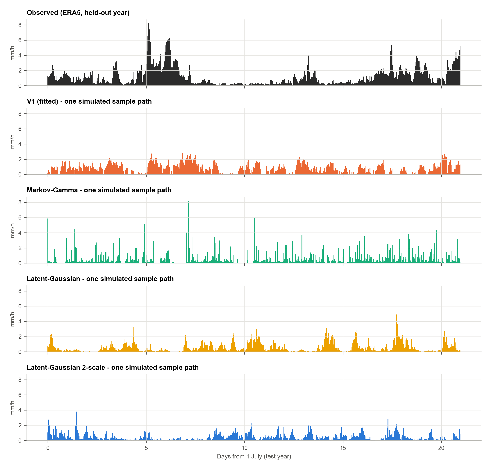
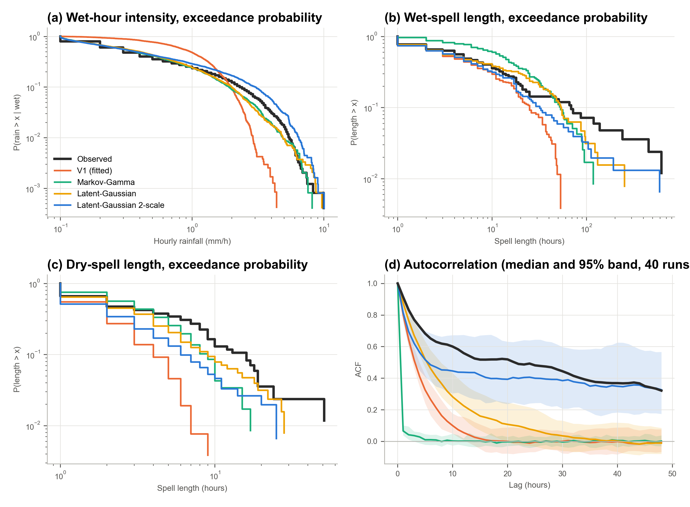
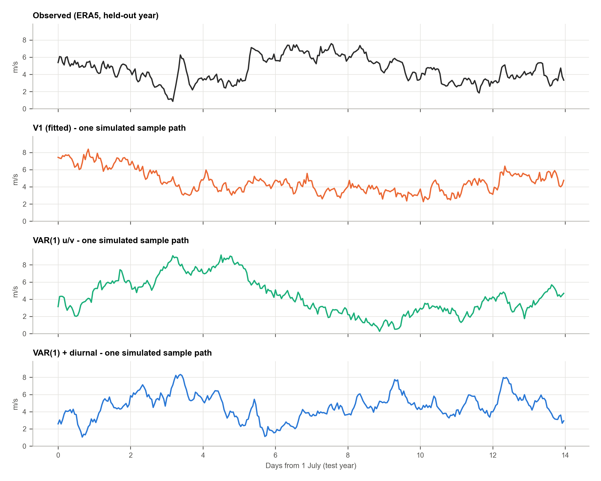
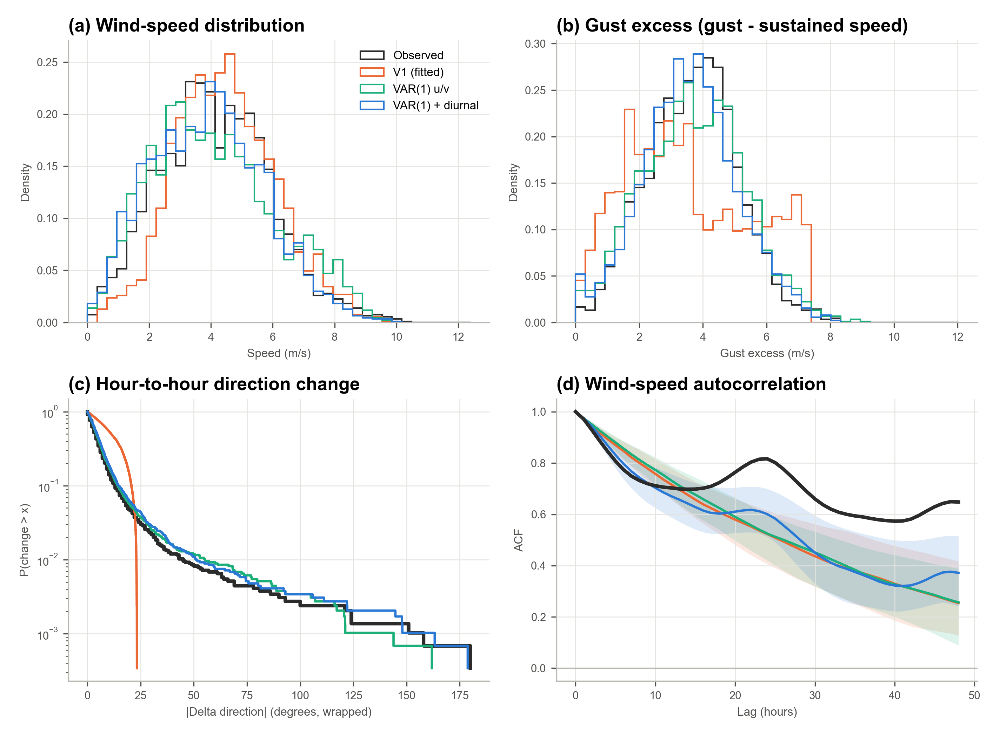
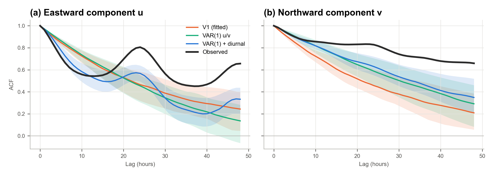
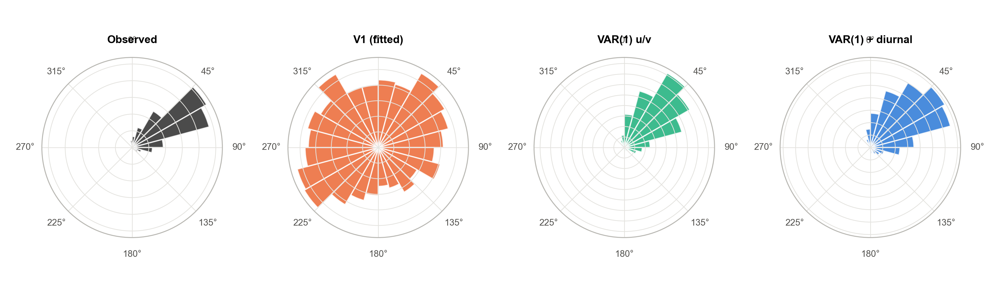

# RescueRoute — Weather-model validation (rainfall and wind)

*Generated by `scripts/validate_weather.py`. Every number in this file is computed from `summary.json`.*

## Scope

This report validates **two** of the simulator's stochastic processes against **one** public data source:

| | |
|---|---|
| Data | ERA5 hourly reanalysis, retrieved through the Open-Meteo Historical Weather API (`models=era5`) |
| Location | Mumbai, Maharashtra (19.0760° N, 72.8777° E). Coastal megacity with recurrent monsoon urban flooding (e.g. 26 July 2005). |
| Period | 2021-01-01 → 2023-12-31, season **JJAS** (south-west monsoon), 0 missing values |
| Split | **fit** on 2021, 2022 (5,856 h) · **test** on the held-out year 2023 (2,928 h) |
| Variables | `precipitation`, `wind_speed_10m`, `wind_direction_10m`, `wind_gusts_10m` (u/v derived from speed and direction) |
| Time step | 1 simulator weather step = 1 hour (the ERA5 cadence). If one step is Δt hours instead, the AR coefficients become ρ^Δt |
| Simulation | 40 independent runs of each model over the test-year length |

**Grading.** ✅ the held-out observed value lies inside the central 95 % range of the 40 simulated runs ·
🟡 the value is outside that range, but the simulated median is within ±20 % of the observation ·
❌ neither. Cells show the simulated median. The *Train years* column shows the spread of the observed statistic across
the training years, which indicates how much a statistic varies naturally from one year to the next.

**We validate the code as implemented, not as described.** The V1 columns run the simulator's own classes:
`weather/rain.py::RainModelV1` (the rain update taken unchanged from the original `hazards/flood.py`) and
`weather/wind.py::WindModel`. The source-audited equations are:

* Rain (normalised, no unit): `R[t+1] = clip(μ + ρ(R[t] − μ) + σ√(1−ρ²)·ε, 0, 1)`. It is mapped to mm/h as `P = R·P_ref`, with `P_ref = 10 mm/h`.
* Wind speed: `V[t+1] = max(0.5, μ + ρ(V[t] − μ) + σ√(1−ρ²)·ε)`. Direction: `θ[t+1] = θ[t] + U(−d, d)`.
  Gust: `G[t+1] ~ U(g_min, g_max)` with probability p, otherwise `G[t+1] = 0.5·G[t]`.

The **V1 (fitted)** column uses V1's equations with parameters estimated from the training years.
The **V1 (default mission)** column uses the average values that `mission.py` currently generates, which shows
whether the scenario defaults need adjusting.

### Candidate models

| Model | Rainfall | Wind |
|---|---|---|
| V1 | clipped Gaussian AR(1) on normalised intensity | AR(1) speed + random-walk direction + Bernoulli gusts |
| Alternative A | **Markov-Gamma**: 2-state wet/dry chain + Gamma amounts (report §10.2) | **VAR(1) u/v**: bivariate AR on wind components (report §10.3) + speed-dependent AR(1) gust excess |
| Alternative B | **Latent-Gaussian**: censored latent AR(1) (meta-Gaussian) | — |
| **Selected for V2** | **Latent-Gaussian 2-scale**: latent Z = √w·Z_fast + √(1−w)·Z_slow, censored at c, Gamma marginal | **VAR(1) + diurnal**: VAR(1) on deviations from a diurnal mean (24 h + 12 h harmonics) |

---

## 1. Rainfall

| Statistic | Observed (test) | Train years (obs. range) | V1 (fitted) | Markov-Gamma | Latent-Gaussian | Latent-Gaussian 2-scale | V1 (default mission) |
|---|---:|---:|---:|---:|---:|---:|---:|
| Mean rainfall (mm/h) | 0.702 | 0.555 – 0.713 | 0.910 ❌ | 0.634 🟡 | 0.628 ✅ | 0.617 ✅ | 5.246 ❌ |
| Std. deviation (mm/h) | 1.102 | 0.826 – 1.016 | 0.718 ❌ | 0.952 🟡 | 0.903 ✅ | 0.807 ✅ | 1.509 ❌ |
| Wet-hour fraction (≥ 0.1 mm) | 0.844 | 0.811 – 0.835 | 0.838 ✅ | 0.825 ✅ | 0.827 ✅ | 0.845 ✅ | 1.000 🟡 |
| P(wet | dry previous hour) | 0.185 | 0.243 – 0.249 | 0.497 ❌ | 0.246 ❌ | 0.244 ❌ | 0.297 ✅ | 1.000 ✅ |
| P(wet | wet previous hour) | 0.966 | 0.943 – 0.951 | 0.903 🟡 | 0.948 🟡 | 0.948 🟡 | 0.946 ✅ | 1.000 🟡 |
| Mean wet-spell length (h) | 29.4 | 17.6 – 20.4 | 10.3 ❌ | 18.9 ❌ | 19.1 ❌ | 18.3 ✅ | 1463.5 ❌ |
| Mean dry-spell length (h) | 5.36 | 4.02 – 4.09 | 2.01 ❌ | 4.06 ❌ | 4.10 ❌ | 3.35 ✅ | 1.00 ❌ |
| Median wet-hour rain (mm/h) | 0.30 | 0.40 – 0.50 | 0.98 ❌ | 0.38 ❌ | 0.38 ❌ | 0.39 ✅ | 5.25 ❌ |
| 90th pct wet-hour rain (mm/h) | 2.30 | 1.60 – 2.10 | 1.99 🟡 | 1.94 🟡 | 1.92 🟡 | 1.65 ✅ | 7.22 ❌ |
| 99th pct wet-hour rain (mm/h) | 5.40 | 4.03 – 5.20 | 2.88 ❌ | 4.79 🟡 | 4.45 ✅ | 3.77 ✅ | 8.81 ❌ |
| Lag-1 autocorrelation | 0.914 | 0.852 – 0.862 | 0.802 🟡 | 0.066 ❌ | 0.876 🟡 | 0.814 🟡 | 0.841 🟡 |
| Lag-6 autocorrelation | 0.651 | 0.482 – 0.560 | 0.264 ❌ | 0.010 ❌ | 0.460 ❌ | 0.484 ✅ | 0.359 ❌ |
| Lag-24 autocorrelation | 0.492 | 0.333 – 0.335 | -0.012 ❌ | -0.003 ❌ | 0.077 ❌ | 0.406 ✅ | 0.012 ❌ |
| Std. of hour-to-hour change | 0.457 | 0.450 – 0.533 | 0.451 ✅ | 1.293 ❌ | 0.453 ✅ | 0.493 ✅ | 0.851 ❌ |
| **Score** | | | **2 ✅ · 3 🟡 · 9 ❌** | **1 ✅ · 5 🟡 · 8 ❌** | **5 ✅ · 3 🟡 · 6 ❌** | **13 ✅ · 1 🟡 · 0 ❌** | **1 ✅ · 3 🟡 · 10 ❌** |

**Fitted parameters (training years only).**

* V1: μ = 0.0634, σ = 0.0928, ρ = 0.860 (normalised). The mission generator's default is μ = 0.525, σ = 0.155, ρ = 0.85.
* Markov-Gamma: p01 = 0.246, p11 = 0.947, amounts − 0.1 mm ~ Gamma(k = 0.460, θ = 1.460).
* Latent-Gaussian 2-scale: p_wet = 0.823 (c = -0.929), w_fast = 0.343, ρ_fast = 0.688, ρ_slow = 0.9968
  (slow e-folding time ≈ -1000000000 h, about the duration of a monsoon active/break spell).

### Findings — rainfall

* **Supported by the data.** V1 has temporal persistence: its fitted lag-1 autocorrelation is 0.802 against
  0.914 observed, so it is not an independent draw every step. V1 statistics that pass or are close: wet-hour fraction (≥ 0.1 mm); p(wet | wet previous hour); 90th pct wet-hour rain (mm/h); lag-1 autocorrelation; std. of hour-to-hour change.
* **Not supported.** The largest V1 discrepancies are: median wet-hour rain (mm/h) (sim 0.975 vs obs 0.3, +225%); p(wet | dry previous hour) (sim 0.497 vs obs 0.185, +169%); lag-24 autocorrelation (sim -0.0116 vs obs 0.492, -102%); mean wet-spell length (h) (sim 10.3 vs obs 29.4, -65%).
  A clipped Gaussian is symmetric and short-memory. It breaks rain into short wet and dry spells, misses the skewed
  wet-hour distribution, and its autocorrelation decays geometrically (-0.012 at 24 h against
  0.492 observed). A Ljung–Box test on the AR(1) residuals gives p = 4.9e-21 at lag 24,
  so AR(1) leaves significant structure unexplained.
* **The mission defaults need adjustment.** The average generated scenario rains 5.25 mm/h
  (+648% against monsoon ERA5) and is wet 100% of the time.
  This is a permanent-storm regime. It is appropriate as a flood *stress* scenario, not as typical conditions.
* **The Markov-Gamma chain alone is insufficient.** It gets occurrence roughly right, but its hourly amounts are independent, so intensity
  autocorrelation collapses (lag-1 ACF 0.066).
* **Selected model.** Latent-Gaussian 2-scale scores 14/14 (✅ or 🟡), against 5/14 for V1 (fitted)
  and 8/14 for the one-scale latent model. Its slow component recovers the multi-day memory
  (lag-24 ACF 0.406 against 0.492 observed). Remaining gaps: none.

---

## 2. Wind

| Statistic | Observed (test) | Train years (obs. range) | V1 (fitted) | VAR(1) u/v | VAR(1) + diurnal | V1 (default mission) |
|---|---:|---:|---:|---:|---:|---:|
| Mean speed (m/s) | 4.15 | 3.87 – 4.02 | 4.09 ✅ | 3.95 ✅ | 3.97 ✅ | 8.38 ❌ |
| Speed std. deviation (m/s) | 1.78 | 1.66 – 2.12 | 1.74 ✅ | 1.83 ✅ | 1.85 ✅ | 2.29 ❌ |
| 5th pct speed (m/s) | 1.39 | 0.81 – 1.40 | 1.32 ✅ | 1.12 ✅ | 1.14 ✅ | 4.59 ❌ |
| 95th pct speed (m/s) | 7.10 | 6.58 – 7.77 | 7.07 ✅ | 7.20 ✅ | 7.20 ✅ | 12.12 ❌ |
| Speed lag-1 autocorrelation | 0.972 | 0.973 – 0.979 | 0.972 ✅ | 0.975 ✅ | 0.975 ✅ | 0.851 🟡 |
| Speed lag-6 autocorrelation | 0.774 | 0.762 – 0.824 | 0.847 🟡 | 0.857 🟡 | 0.797 ✅ | 0.372 ❌ |
| Speed lag-24 autocorrelation | 0.817 | 0.708 – 0.844 | 0.524 ❌ | 0.525 ❌ | 0.601 ❌ | 0.020 ❌ |
| Std. of hourly speed change | 0.416 | 0.384 – 0.431 | 0.408 ✅ | 0.404 ✅ | 0.407 ✅ | 1.258 ❌ |
| Mean eastward component u (m/s) | 3.03 | 2.62 – 2.69 | 0.08 ❌ | 2.59 ✅ | 2.67 ✅ | -0.02 ✅ |
| Mean northward component v (m/s) | 2.00 | 2.18 – 2.27 | 0.04 ❌ | 2.21 ✅ | 2.22 ✅ | 0.32 ✅ |
| u lag-1 autocorrelation | 0.964 | 0.967 – 0.974 | 0.967 ✅ | 0.972 ✅ | 0.971 🟡 | 0.977 🟡 |
| v lag-1 autocorrelation | 0.984 | 0.976 – 0.985 | 0.967 🟡 | 0.981 ✅ | 0.981 ✅ | 0.977 🟡 |
| Directional steadiness R (0–1) | 0.823 | 0.738 – 0.874 | 0.101 ❌ | 0.804 ✅ | 0.804 ✅ | 0.224 ❌ |
| Std. hourly direction change (°) | 12.0 | 10.3 – 15.9 | 13.4 🟡 | 12.6 ✅ | 12.2 ✅ | 8.7 ❌ |
| 90th pct abs. direction change (°) | 13.0 | 13.0 – 17.0 | 20.9 ❌ | 14.4 ✅ | 14.1 ✅ | 13.5 🟡 |
| Mean gust excess (m/s) | 3.68 | 3.37 – 3.88 | 3.60 ✅ | 3.66 ✅ | 3.65 ✅ | 1.63 ❌ |
| 95th pct gust excess (m/s) | 5.96 | 6.15 – 6.22 | 6.96 🟡 | 6.14 ✅ | 6.15 ✅ | 6.35 🟡 |
| Gust-excess lag-1 autocorrelation | 0.900 | 0.907 – 0.938 | 0.168 ❌ | 0.885 ✅ | 0.885 ✅ | 0.402 ❌ |
| **Score** | | | **8 ✅ · 4 🟡 · 6 ❌** | **16 ✅ · 1 🟡 · 1 ❌** | **16 ✅ · 1 🟡 · 1 ❌** | **2 ✅ · 5 🟡 · 11 ❌** |

**Fitted parameters (training years only).**

* V1: μ_V = 3.94 m/s, σ_V = 1.90, ρ_V = 0.977, drift d = 23.2°,
  gust p = 0.664, U(1.67, 7.39) m/s. The mission generator's default is μ_V = 8.4 m/s, σ_V = 2.30, ρ = 0.85, drift = 15°.
* VAR(1) + diurnal: mean (u, v) = (2.66, 2.22) m/s, A = [[0.970, 0.020], [-0.006, 0.985]],
  gust excess = 1.25 + 0.600·S + AR(1) noise (φ = 0.770).

### Findings — wind

* **Supported by the data.** V1's AR(1) speed process reproduces the speed level, spread and short-term persistence: mean 4.09 against
  4.15 m/s; lag-1 ACF 0.972 against 0.972. V1 statistics that pass or are close: mean speed (m/s); speed std. deviation (m/s); 5th pct speed (m/s); 95th pct speed (m/s); speed lag-1 autocorrelation; speed lag-6 autocorrelation; std. of hourly speed change; u lag-1 autocorrelation; v lag-1 autocorrelation; std. hourly direction change (°); mean gust excess (m/s); 95th pct gust excess (m/s).
* **Not supported.** The largest V1 discrepancies are: mean northward component v (m/s) (sim 0.0381 vs obs 2, -98%); mean eastward component u (m/s) (sim 0.0758 vs obs 3.03, -97%); directional steadiness r (0–1) (sim 0.101 vs obs 0.823, -88%); gust-excess lag-1 autocorrelation (sim 0.168 vs obs 0.9, -81%).
  An unbounded random-walk direction has no prevailing wind over a season (R = 0.10),
  whereas the monsoon flow is strongly organised (R = 0.82, blowing toward ≈59°).
  V1 gusts are rare, decaying events; ERA5 reports a persistent, speed-dependent gust excess (lag-1 ACF 0.90).
* **The mission defaults need adjustment.** The average generated wind of 8.4 m/s is +102% against
  the ERA5 mean for this grid cell. Treat it as a strong-wind scenario. Note that ERA5 smooths local extremes and urban channelling.
* **Selected model.** VAR(1) + diurnal scores 17/18, against 12/18 for V1 (fitted).
  It reproduces the prevailing direction (R = 0.80) and the persistent gusts, and it avoids
  angle wrap-around problems entirely. The diurnal terms raise the 24 h speed autocorrelation from 0.525
  to 0.601 (observed 0.817). Remaining gaps: speed lag-24 autocorrelation (sim 0.601 vs obs 0.817, -26%).
* **Residual diagnostics.** Ljung–Box p-values at lag 24 (training data): V1 speed AR(1) 0.0e+00;
  VAR u 0.0e+00; VAR + diurnal u 8.8e-120.
  With about 6,000 hourly samples, even small remaining correlation is significant. All first-order models are therefore
  approximations beyond a few hours.

---

## 3. Conclusions

**Claim supported by this validation (modest):** *the simulator's stochastic rainfall and wind models reproduce basic
temporal characteristics of historical hourly weather, including variability and short-term persistence.* For wind
speed, the V1 process is adequate as implemented. This does **not** establish that RescueRoute is a weather-forecasting
system.

**What needs adjustment, and what was done about it**

| Issue found | Action taken (Environment V2, `weather_model="v2"`) |
|---|---|
| Clipped-Gaussian rain has short spells, wrong intensity shape and short memory | Latent-Gaussian **two-scale** censored AR(1) rain process |
| Random-walk wind direction has no prevailing wind | VAR(1) on (u, v) with a diurnal mean |
| Gusts as rare decaying events | Continuous, speed-dependent AR(1) gust excess |
| Mission defaults (rain μ ≈ 0.53, wind μ_V ≈ 8.4 m/s) far above monsoon climatology | Kept as V1 stress profiles. V2 parameters in `configs/weather_v2_calibrated.json` represent typical monsoon conditions |

Environment **V1 is frozen and unchanged**, so every RL baseline remains comparable. V2 is an explicit, versioned option.

**What remains unvalidated**

* The **flood cellular automaton** (spread kernel, rain → flood and wind → flood coupling, no recession) and the flood-forecast
  reliability blend. These stay synthetic, controlled-simulation components. Calibrating them requires time-stamped
  flood masks (e.g. repeated Sentinel-1 acquisitions), not maximum-extent products. In V2, the rain → flood driver is an antecedent
  rainfall index, `clip(API_t / P_ref, 0, 1)` with `API_t = 0.8·API_(t−1) + 0.2·P_t`. This is a modelling choice, **not** a validated relation.
* The choice of **one simulator step = one hour** of weather. It is a modelling decision.
* **Spatial scale.** An ERA5 cell (~28 km) is much larger than the whole Manhattan32 map, so urban micro-scale wind and convective rain peaks are smoothed.
* **Other regimes.** Only one location and one season were tested. Re-run with, for example, `--location chennai --season OND`.

*Data: ERA5 (Hersbach et al., 2020; Copernicus Climate Change Service) via Open-Meteo (CC BY 4.0).*
